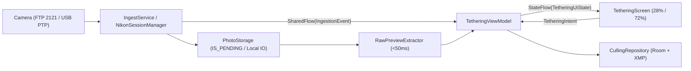

# AirTether KMP Architecture & Branch Guide

이 문서는 **AirTether-KMP**의 멀티플랫폼 모듈 구조, 공통 패키지 레이아웃, MVI/UDF 데이터 흐름, 그리고 기능별 브랜치 현황을 정의합니다.

---

## 1. Repository & Module Structure

```text
AirTether-KMP/
├── shared/                 # KMP 공통 모듈 (UI, ViewModel, Models, Ports, RAW 파서)
│   └── src/
│       ├── commonMain/     # 공통 Compose UI, MVI, 모델, 포트 인터페이스
│       ├── androidMain/    # Foreground Service(FTP 2121), MediaStore(IS_PENDING), USB Host
│       ├── jvmMain/        # Desktop JVM 파일 스토리지 및 네트워크/USB 어댑터
│       └── iosMain/        # iOS Photos 프레임워크 내보내기 및 라이프사이클 관리
├── core/
│   └── nikon-ptp/          # Nikon PTP 프로토콜, LiveView 파서, USB/TCP/Mock 트랜스포트, FramePacer
├── app-director/           # Android 전용 3-Layer LiveView 시네마 모니터 앱 (OpenGL ES 3.0 3D LUT)
├── androidApp/             # Android 테더링 뷰어 엔트리포인트
├── desktopApp/             # Desktop(JVM) 테더링 뷰어 엔트리포인트
├── iosApp/                 # iOS Xcode 프로젝트 (SwiftUI 래퍼)
└── docs/                   # 아키텍처 및 설계 문서
```

---

## 2. Common Package Layout (`shared/src/commonMain`)

기본 패키지 루트: `com.dynast.airtether`

```text
com.dynast.airtether
├── model
│   └── TetheringModels.kt        # TransferStatus, ExifMetadata, TetherMediaItem, ServerStatus, TetheringUiState
├── domain
│   └── port                      # feature 브랜치가 구현하는 추상화 계층 (DIP)
│       ├── IngestService.kt      # FTP(2121) / USB PTP 수신 이벤트 스트림 (SharedFlow<IngestionEvent>)
│       ├── PtpSessionManager.kt  # USB PTP 단일 세션 관리 (:core:nikon-ptp 연동)
│       ├── RawPreviewExtractor.kt# 디모자이킹 없이 임베디드 Preview JPEG + EXIF 추출 (<50ms)
│       ├── PhotoStorage.kt       # 플랫폼별 저장소 (IS_PENDING / Local IO)
│       └── CullingRepository.kt  # Room KMP 로컬 DB 및 XMP 사이드카 파일 생성
├── viewmodel
│   └── TetheringViewModel.kt     # TetheringIntent, IngestionEvent, StateFlow<TetheringUiState>
└── ui
    ├── TetheringScreen.kt        # 태블릿 가로 기준 28% 필름스트립 / 72% 메인 뷰어 레이아웃
    ├── theme/
    │   └── AirTetherTheme.kt     # 다크 스튜디오 테마
    └── components/
        ├── TetheringTopBar.kt    # FTP 서버 상태, 세션명, Live Follow 토글
        ├── FilmstripPanel.kt     # 28% 필름스트립 리스트, 전송 진행률, RAW/JPG 뱃지
        └── MainViewerPanel.kt    # 72% 인터랙티브 뷰어 (핀치/더블탭 1:1 줌, EXIF 오버레이, 별점)
```

---

## 3. Core Data Flow (MVI / UDF)



### 핵심 설계 원칙
1. **USB PTP 세션 단일화 (`PtpSessionManager` / `NikonSessionManager`)**
   - 파일 인제스천(`feature/ingest-ftp-usb`)과 라이브뷰(`feature/ptp-liveview`)가 동일한 Android `UsbDeviceConnection`을 점유하지 않도록 단일 세션 매니저가 트랜잭션을 조율합니다.
2. **초고속 RAW 프리뷰 (`RawPreviewExtractor`)**
   - Full RAW Bayer 디모자이킹을 수행하지 않고, TIFF/ISOBMFF 바이트 오프셋에서 임베디드 Full-size Preview JPEG만 추출해 `<50ms` 이내에 뷰어로 전달합니다.
3. **안전한 파일 저장 (`PhotoStorage`)**
   - Android는 MediaStore `IS_PENDING = 1` 상태로 수신 후 완료 시 `0`으로 전환해 갤러리/뷰어 손상 노출을 방지합니다.

---

## 4. Branch Status & Strategy

| 브랜치 | 상태 | 담당 영역 |
| :--- | :--- | :--- |
| `chore/core-architecture` | 기반 정리 완료 | 공통 포트(`domain/port`), 뷰어 모델/UI 기준 최신화, 아키텍처 문서 |
| `feature/tethering-viewer-ui` | **MVP 구현 완료** | 28/72 태블릿 2패널 UI, `TetheringModels`, `TetheringViewModel`, 단위 테스트 |
| `feature/ptp-liveview` | **코어 & 모니터 구현 완료** | `:core:nikon-ptp` (PTP/LiveView/FramePacer) & `:app-director` (OpenGL ES 3D LUT) |
| `feature/ingest-ftp-usb` | 구현 예정 | FTP(포트 2121) Ktor 리스너, USB PTP 파일 수신, `PhotoStorage` 구현 |
| `feature/raw-fast-preview` | 구현 예정 | TIFF/ISOBMFF 바이트 오프셋 기반 임베디드 JPEG & EXIF 추출기 |
| `feature/culling-room-xmp` | 구현 예정 | Room KMP 기반 별점 영속화 및 `.xmp` 사이드카 생성 |
