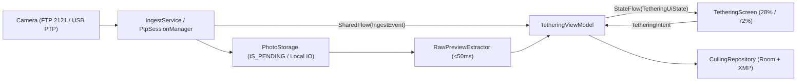

# AirTether KMP Architecture & Branch Guide

이 문서는 **AirTether-KMP**의 멀티플랫폼 모듈 구조, 공통 패키지 레이아웃, MVI/UDF 데이터 흐름, 그리고 기능별 브랜치 운영 전략을 정의합니다.

---

## 1. Repository & Module Structure

```text
AirTether-KMP/
├── shared/                 # KMP 공통 모듈 (UI, ViewModel, Domain, Parsers, Storage Port)
│   └── src/
│       ├── commonMain/     # 공통 Compose UI, MVI, 도메인 모델, 포트 인터페이스, RAW 파서
│       ├── androidMain/    # Foreground Service(FTP 2121), MediaStore(IS_PENDING), USB Host
│       ├── jvmMain/        # Desktop JVM 파일 스토리지 및 USB/네트워크 어댑터
│       └── iosMain/        # iOS Photos 프레임워크 내보내기 및 라이프사이클 관리
├── androidApp/             # Android 앱 엔트리포인트 (Manifest, 권한, Service 바인딩)
├── desktopApp/             # Desktop(JVM) 앱 엔트리포인트
├── iosApp/                 # iOS Xcode 프로젝트 (SwiftUI 래퍼)
└── docs/                   # 아키텍처 및 설계 문서
```

---

## 2. Common Package Layout (`shared/src/commonMain`)

기본 패키지 루트: `com.dynast.airtether`

```text
com.dynast.airtether
├── domain
│   ├── model
│   │   ├── PhotoItem.kt          # 사진 엔티티 (id, fileName, format, 경로, 전송상태, EXIF, 컬링)
│   │   ├── PhotoFormat.kt        # RAW (CR3/ARW/NEF/RAF/DNG) / JPEG 구분
│   │   ├── ExifData.kt           # 바디, 렌즈, 초점거리, 조리개, 셔터스피드, ISO, 촬영시각
│   │   ├── CullingMetadata.kt    # 별점(0..5), 플래그(PICK/REJECT/NONE), 컬러라벨
│   │   ├── ConnectionState.kt    # Disconnected / FtpListening(2121) / UsbConnected
│   │   └── LiveViewFrame.kt      # PTP 라이브뷰 JPEG 바이트 및 프레임 메타데이터
│   └── port                      # feature 브랜치가 구현하는 추상화 계층 (DIP)
│       ├── IngestService.kt      # FTP(2121) / USB PTP 수신 이벤트 스트림 (SharedFlow)
│       ├── PtpSessionManager.kt  # USB PTP 단일 세션 관리 (파일 인제스천 + 라이브뷰 공존)
│       ├── RawPreviewExtractor.kt# 디모자이킹 없이 임베디드 Preview JPEG + EXIF 추출 (<50ms)
│       ├── PhotoStorage.kt       # 플랫폼별 저장소 (expect/actual)
│       └── CullingRepository.kt  # Room KMP 로컬 DB 및 XMP 사이드카 파일 생성
├── presentation
│   ├── TetheringUiState.kt       # 단일 UI 상태 (StateFlow<TetheringUiState>)
│   ├── TetheringIntent.kt        # 사용자 액션 (사진 선택, 1:1 줌, 라이브뷰, 컬링)
│   ├── TetheringEffect.kt        # 일회성 이벤트 (신규 수신 스크롤, 에러 토스트)
│   └── TetheringViewModel.kt     # Intent 처리 및 StateFlow / SharedFlow 조율
└── ui
    ├── TetheringScreen.kt        # 태블릿 가로 기준 28% 필름스트립 / 72% 메인 뷰어 레이아웃
    ├── filmstrip/                # 필름스트립 리스트, 전송 진행률, RAW/JPG 뱃지
    └── viewer/                   # 인터랙티브 뷰어 (핀치 줌, 1:1 더블탭 줌, EXIF 오버레이, 라이브뷰)
```

---

## 3. Core Data Flow (MVI / UDF)



### 핵심 설계 원칙
1. **USB PTP 세션 단일화 (`PtpSessionManager`)**
   - 파일 인제스천(`feature/ingest-ftp-usb`)과 라이브뷰(`feature/ptp-liveview`)가 동일한 Android `UsbDeviceConnection`을 점유하지 않도록 단일 세션 매니저가 트랜잭션 큐/뮤텍스로 조율합니다.
2. **초고속 RAW 프리뷰 (`RawPreviewExtractor`)**
   - Full RAW Bayer 디모자이킹을 수행하지 않고, TIFF/ISOBMFF 바이트 오프셋에서 임베디드 Full-size Preview JPEG만 추출해 `<50ms` 이내에 뷰어로 전달합니다.
3. **안전한 파일 저장 (`PhotoStorage`)**
   - Android는 MediaStore `IS_PENDING = 1` 상태로 수신 후 완료 시 `0`으로 전환해 갤러리/뷰어 손상 노출을 방지합니다.

---

## 4. Branch Strategy

모든 `feature/*` 브랜치는 `chore/core-architecture`에서 공통 모델·포트·MVI 계약을 정의한 뒤 이를 기반으로 분기하여 병렬 개발합니다.

| 브랜치 | 목적 | 주요 작업 모듈 |
| :--- | :--- | :--- |
| `chore/core-architecture` | 의존성(`ktor`, `coil3`, `room`, `kotlinx-io`) 및 공통 도메인/포트/MVI 계약 정의 | `shared/commonMain` |
| `feature/ingest-ftp-usb` | FTP(포트 2121) 리스너, USB PTP 파일 수신, 플랫폼별 스토리지 저장 | `commonMain`, `androidMain`, `jvmMain`, `iosMain` |
| `feature/ptp-liveview` | USB PTP 라이브뷰 프레임 스트리밍 및 원격 셔터/카메라 제어 | `commonMain`, `androidMain`, `jvmMain` |
| `feature/raw-fast-preview` | TIFF/ISOBMFF 바이트 오프셋 기반 임베디드 JPEG & EXIF 추출기 | `commonMain` |
| `feature/tethering-viewer-ui` | 28/72 태블릿 레이아웃, 필름스트립, 핀치/더블탭 1:1 줌, 플로팅 EXIF | `commonMain` |
| `feature/culling-room-xmp` | Room KMP 기반 별점/플래그/라벨 영속화 및 `.xmp` 사이드카 생성 | `commonMain` |
